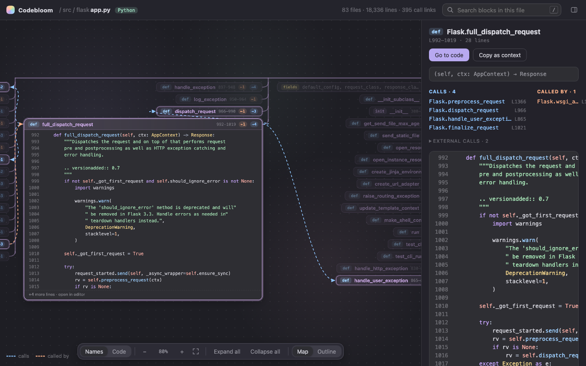
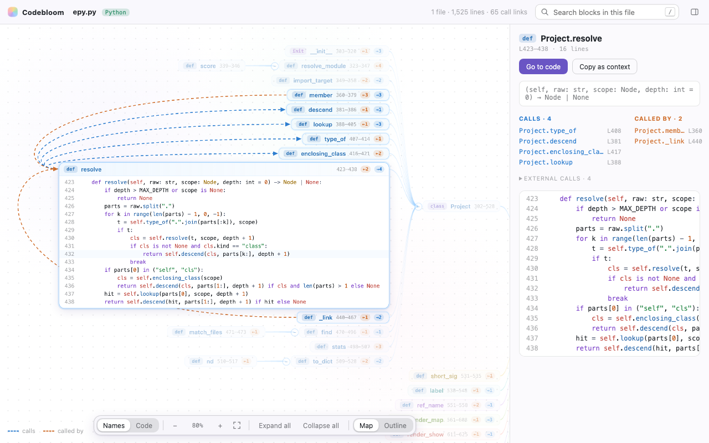
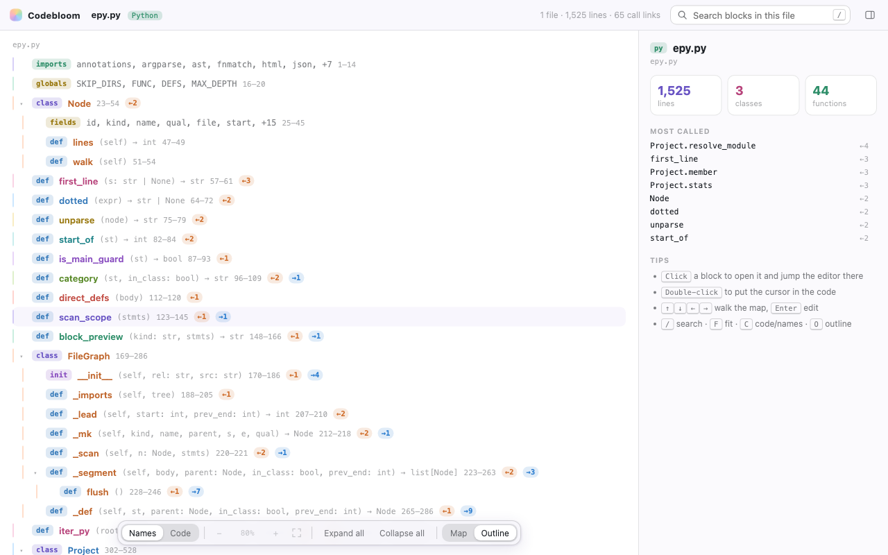

# Codebloom: code mind maps for VS Code

**See any Python, Java or JavaScript file as a mind map, with the real code on every branch.**

Codebloom splits a file into its blocks (imports, globals, classes, methods, functions and the entry point) and lays them out around the file name in soft pastel branches. Click any block to open its code in place and jump the editor to it. Arrows show what it calls and what calls it, including calls into other files in your workspace.

## Why

People read long files from top to bottom, but code is a graph. Codebloom shows both: the shape of the whole file as a map, any block's code one click away, and your real editor right beside it, kept in sync.

Codebloom is inspired by [epy (Extended Python)](https://github.com/phoenix2610/Extended_Programming). It is a separate implementation built for the editor:

- **Built into the editor.** It runs inside VS Code, with no Python process to start and no browser page to rebuild. Parsing uses tree-sitter compiled to WebAssembly, in-process.
- **Live.** The map updates as you type. Re-parsing a 1,600-line file takes about 9 ms.
- **Opens before indexing finishes.** The current file is mapped immediately. The rest of the workspace is indexed in the background so cross-file links fill in on their own.
- **Fast on big files.** Layout is computed from text metrics, and only the blocks on screen are rendered.
- **Three languages:** Python, Java and JavaScript (including JSX).

## Getting started

1. Open a `.py`, `.java`, `.js`, `.mjs`, `.cjs` or `.jsx` file.
2. Click the **Codebloom** icon in the editor title bar, press <kbd>Cmd</kbd>+<kbd>Alt</kbd>+<kbd>M</kbd> (<kbd>Ctrl</kbd>+<kbd>Alt</kbd>+<kbd>M</kbd> on Windows/Linux), or run **Codebloom: Open Mind Map** from the Command Palette.
3. The map opens beside your code and follows whichever supported file you switch to.

## Features

| | |
|---|---|
| **Names and Code modes** | Names mode shows labels and opens only the selected block as code. Code mode shows every block as a code card. |
| **Call arrows** | Select a block to see what it calls (blue) and what calls it (peach). |
| **Cross-file links** | Resolves imports, `self`/`this`, inheritance, simple local typing (`x = Foo()`, `Foo x = new Foo()`), Java packages, static imports and overloads, JS `require`, default exports and `Foo.prototype.bar = function` patterns. |
| **Editor sync** | Clicking a block scrolls the editor to it. Moving the cursor in the editor highlights its block in the map. |
| **Details panel** | Shows the signature, docs, calls, callers, external calls and a highlighted preview, plus **Copy as context** to paste a block and its call graph into an LLM chat. |
| **Outline view** | The same structure as an indented list. |
| **Search** | Press <kbd>/</kbd> to jump to any block by name, with fuzzy matching. |
| **Folding** | Fold any class or function. **Expand all** and **Collapse all** work on the whole file. |
| **Theme aware** | The pastel palette has tuned light and dark variants and follows your VS Code theme. |

## Keyboard

| Key | Action |
|---|---|
| <kbd>/</kbd> | Search blocks |
| <kbd>↑</kbd> <kbd>↓</kbd> | Previous / next sibling |
| <kbd>←</kbd> <kbd>→</kbd> | Parent / first child (mirrored on the left side of the map) |
| <kbd>Enter</kbd> | Put the cursor in the selected block |
| <kbd>Space</kbd> | Fold / unfold |
| <kbd>C</kbd> | Toggle Names / Code |
| <kbd>O</kbd> | Toggle Map / Outline |
| <kbd>F</kbd> | Fit the map |
| <kbd>+</kbd> <kbd>-</kbd> <kbd>0</kbd> | Zoom in / out / reset |
| <kbd>D</kbd> | Show or hide the details panel |
| <kbd>Esc</kbd> | Deselect |
| <kbd>?</kbd> | Show the shortcut list |

Drag the background to pan. Use the mouse wheel or a pinch to zoom; two-finger scrolling on a trackpad pans.

## Commands

- **Codebloom: Open Mind Map**: map the active file.
- **Open in Codebloom Mind Map**: from the Explorer context menu.
- **Codebloom: Copy Block at Cursor as LLM Context**: also in the editor context menu.
- **Codebloom: Re-index Workspace**

## Settings

| Setting | Default | |
|---|---|---|
| `codebloom.defaultMode` | `names` | Start in `names` or `code` mode. |
| `codebloom.maxCardLines` | `24` | Longest code shown on a card before it is cut off. |
| `codebloom.followActiveEditor` | `true` | Switch the map when you switch files. |
| `codebloom.syncCursor` | `true` | Highlight the block under the cursor. |
| `codebloom.revealOnClick` | `true` | Clicking a block scrolls the editor to it. |
| `codebloom.indexWorkspace` | `true` | Index the workspace for cross-file links. |
| `codebloom.maxFiles` | `4000` | Upper limit on indexed files. |
| `codebloom.exclude` | `node_modules`, `.git`, `venv`, `dist`, `build`, … | Globs the index skips. |

## Limits

Call resolution is static and best-effort. It cannot link calls whose target is only known at runtime: `getattr`, functions stored in dicts, or methods on objects whose type is not visible (for example, an untyped function parameter). Those calls are listed under **External calls**. Functions defined inside a top-level `if` or `try` are part of that statement's block rather than getting their own.

## Privacy

Everything runs locally. Codebloom makes no network requests and collects no telemetry.

## License

MIT
